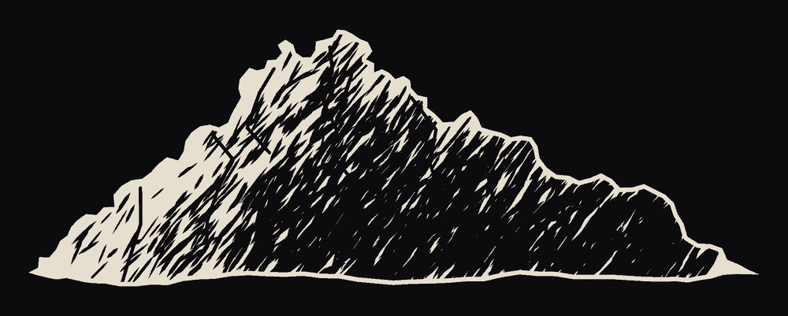
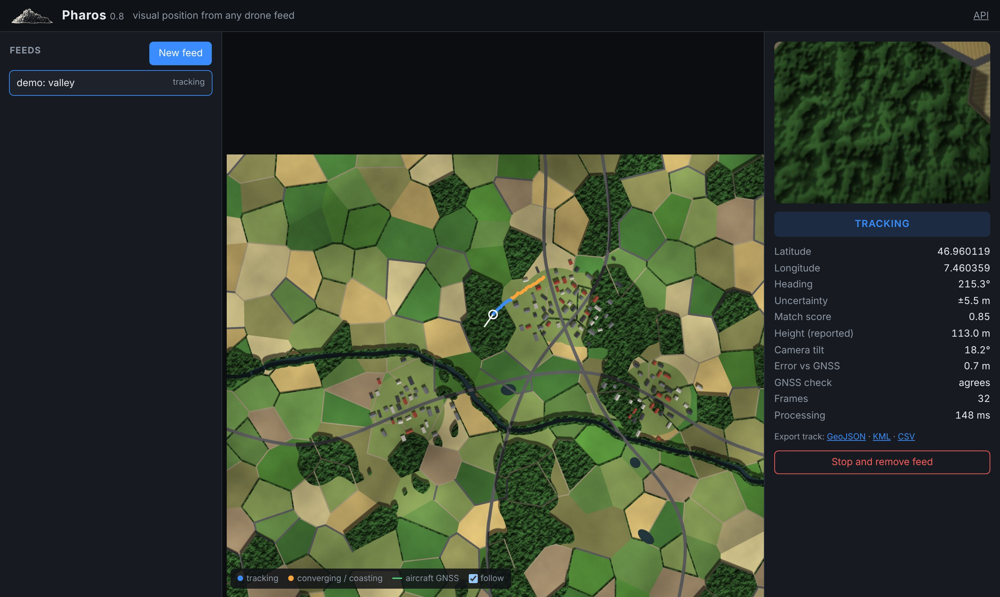
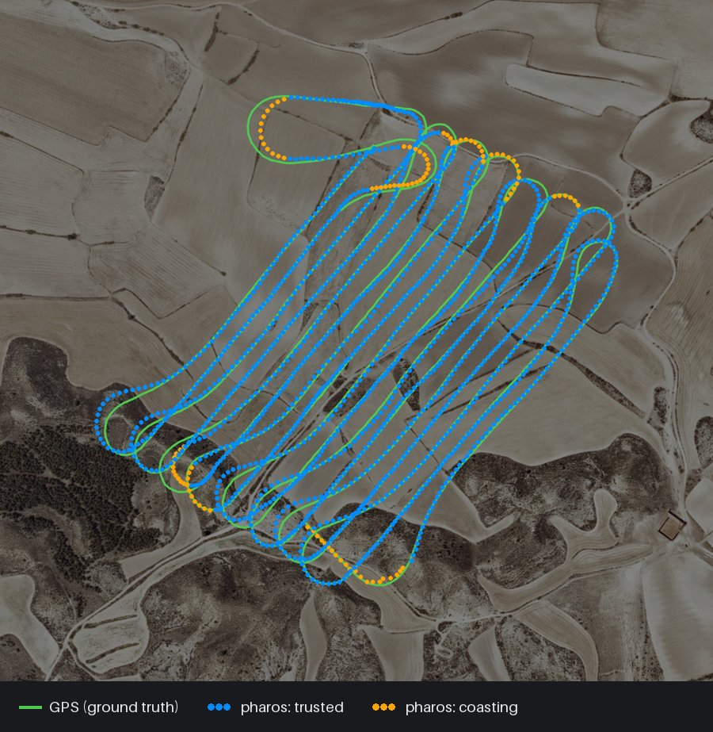
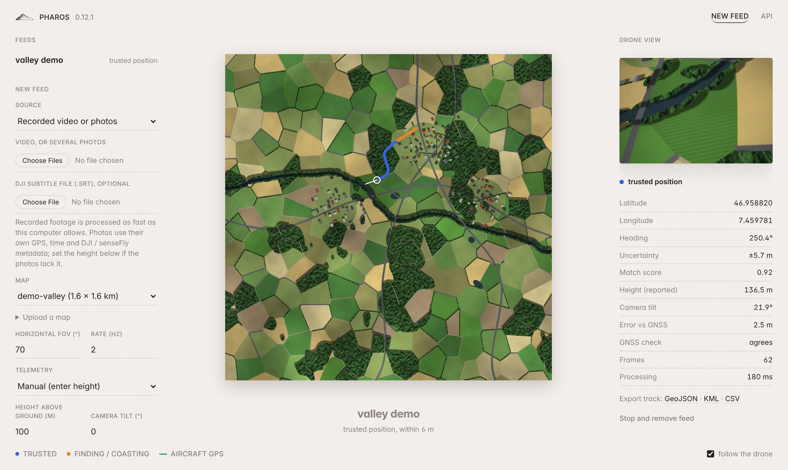

<p align="center">
  
</p>

<h1 align="center">Pharos 0.13</h1>

<p align="center">
  <a href="https://github.com/ahroonsanthosh/pharos/actions/workflows/ci.yml"></a>
</p>

I built Pharos because an operator should know where a drone is regardless of GPS availability. It looks down through the camera, compares what it sees
with free satellite and aerial maps, and works out its position from that
alone. Jammed, spoofed or just missing GPS, it keeps going.

It runs on a normal laptop CPU. You give it a video feed plus MAVLink (ArduPilot, PX4) or DJI
telemetry, live or recorded, and it gives you a position.



## Important to note

Every position comes with an uncertainty, and Pharos only
calls a position "trusted" when independent evidence backs it up. A
navigation system that is confidently wrong is worse than having none, so
that rule shaped almost every decision in here.

On public real flights (GPS used only to score it):

| Flight                                  | Trusted within 25 m | Live, in flight | Trusted but wrong |
| --------------------------------------- | ------------------: | --------------: | ----------------: |
| Farmland survey, fixed-wing, 13 min     |                 92% |             63% |              none |
| River valley survey, fixed-wing, 15 min |                 91% |             52% |              none |

Across 31 simulated scenarios (snow, haze, low sun, Irish bog and uplands,
a frozen video link, GPS jammed at 50 m, a spoofed starting fix and more)
it never trusts a wrong position. You can check that yourself with
`pharos bench`. The full numbers, the DJI footage I tested on and the ideas
I tried and threw away are in [docs/results.md](docs/results.md).



<sub>A real flight: Pharos from the video alone (blue trusted, orange
coasting) over the GPS track (green). Orthophoto: PNOA © Instituto
Geográfico Nacional, CC BY 4.0.</sub>

## Run it on your own computer

Pharos is meant to run on your own machine. Nothing is sent anywhere, it
needs no account, and after the first start it works without internet.
Any recent laptop works: Windows, macOS or Linux. There are two ways to
install it; pick one.

### Option A: with Python

You need [Git](https://git-scm.com/downloads) and
[Python 3.11 or newer](https://www.python.org/downloads/). On Windows, tick
**Add python.exe to PATH** when installing Python. Open a terminal
(**PowerShell** on Windows, **Terminal** on macOS and Linux) and type each
line on its own, pressing Enter after each one.

**1. Download Pharos** (once):

```
git clone https://github.com/ahroonsanthosh/pharos.git
cd pharos
```

**2. Install it** into its own folder, `.venv`, so nothing else on your
computer is touched (once; takes a minute or two):

Windows (PowerShell):

```powershell
python -m venv .venv
.\.venv\Scripts\python -m pip install -e ".[server,geo]"
```

macOS and Linux:

```bash
python3 -m venv .venv
.venv/bin/python -m pip install -e ".[server,geo]"
```

**3. Start it.** Your browser opens the dashboard at
**http://localhost:8000**:

Windows (PowerShell):

```powershell
.\.venv\Scripts\pharos serve --open
```

macOS and Linux:

```bash
.venv/bin/pharos serve --open
```

Stop it with `Ctrl+C` in the terminal. **Next time**, open a terminal, go
into the folder with `cd pharos`, and run step 3 again.

**To update** to the latest version later, from the `pharos` folder run
`git pull`, then step 2's second line again.

### Option B: with Docker (includes live-stream support)

Install [Docker Desktop](https://www.docker.com/products/docker-desktop/)
(Docker Engine on Linux) and start it. Then, after step 1 above:

```
docker compose up
```

The first start builds everything and takes a few minutes; after that it
starts in seconds. Open **http://localhost:8000**. Stop it with `Ctrl+C`.
Your maps and uploaded videos stay in the `pharos-data` folder. This option
also runs [MediaMTX](https://github.com/bluenviron/mediamtx), which receives
video pushed from a drone controller or OBS; with Option A, run MediaMTX
yourself if you need that.

### If something goes wrong

* **`'pharos' is not recognized`** or **`does not appear to be a Python
  project`**: you are not inside the `pharos` folder, or skipped step 2.
  Run `cd pharos` first, and start Pharos with the full path from step 3.
* **`The module '.venv' could not be loaded`** or **`no such option`**:
  step 2 didn't finish. Run its second line again on its own, paste it
  only once, and wait until it ends before starting Pharos.
* **`'&&' is not a valid statement separator`**: older PowerShell runs one
  command per line. Type each line separately.
* **`python` is not found, or the version is below 3.11**: install Python
  from python.org (tick **Add python.exe to PATH**), then open a new
  terminal.
* **`destination path 'pharos' already exists`**: you downloaded it before.
  Run `cd pharos`, then `git pull` to update it.
* **The page doesn't open**: go to http://localhost:8000 yourself while the
  terminal is still running.

### First run

Click **Start the demo flight**. A simulated flight is generated and tracked
live in about 15 s. After that, use **New feed** for your own footage: a DJI
controller or OBS over RTMP/SRT, RTSP/HLS/UDP streams, a capture card or
webcam, or recorded video with its DJI `.SRT` file. If the drone reports
GPS, I draw it next to the estimate so you can judge the accuracy for
yourself. **Map / Camera** under the main view switches it to the drone's
own video (or click the small drone view), and **Clear** empties the feeds
list. Setup for each source, ports and firewall notes are in
[docs/laptop.md](docs/laptop.md).



**Start from GPS** takes one fix at takeoff and never uses GPS again, so
jamming later on can't drag it off course. The **GNSS check** then flags a
receiver that looks confident but is drifting away, which is exactly what a
spoofed one does.

## Recorded footage

From the `pharos` folder (with Option A, write `.\.venv\Scripts\pharos` on
Windows or `.venv/bin/pharos` on macOS and Linux instead of `pharos`):

```bash
pharos analyze DJI_0042.MP4 --map area.tif --hfov 70
pharos analyze photos/ --map area.tif
pharos analyze old.mp4 --map area.tif --hfov 70 --altitude 120
```

You get the track as GeoJSON, KML (opens in Google Earth) and CSV, plus a
summary that scores Pharos against the footage's own GPS if it has any.
`pharos --help` covers syncing a camera to an autopilot log, calibrating a
camera and starting from a known position.

## Put it online

You don't need to, but if you want others to try it in a browser, a free
Hugging Face Space works, and pushes to `main` keep it up to date. A public
server runs in a safe mode: demo flights, the visitor's own camera and
uploaded footage only. Steps in [docs/deploy.md](docs/deploy.md).

## How it works

1. **Rectify** each frame onto the ground using height, tilt and a terrain
   model.
2. **Describe** frame and map as edges (roads, field boundaries, buildings,
   shorelines) so colour, season and shadows matter less.
3. **Match** every position on the map at once with FFT cross-correlation,
   across headings and scales.
4. **Track** several candidates until one clearly wins, then fuse map
   matches with visual odometry, gyro and compass. When matches dry up it
   dead-reckons with a growing uncertainty.

Any north-up orthophoto works as a map: USGS NAIP, IGN, swisstopo, PDOK,
OpenAerialMap or Sentinel-2. More detail in
[docs/architecture.md](docs/architecture.md).

## Working on it

With the environment from Option A activated (or using its full paths):

```bash
pip install -e ".[dev,server,geo]"
pytest -q
pharos bench -j 4 -o runs/bench
pharos serve --open
```

Next on my list: a real flight over Irish pasture or bog, learned features
as an optional matcher, and lens distortion correction. A faster first fix
for low flights is in as an opt-in: in simulation it gets a position in
about 6 s instead of 10, and at 40 m over pasture where it used to find
none, but I want it to hold on real flights before it becomes the default
([details](docs/results.md#confirming-by-frame-lengths-pharos-09-off-by-default)).

## License

Copyright (C) 2026 Ahroon Santhosh. Free software under the
[GNU AGPL v3.0](LICENSE). If you need it for proprietary use, a commercial
licence is available from Heloria Labs: get in touch through
[@ahroonsanthosh](https://github.com/ahroonsanthosh). Outside contributions
are accepted under a contributor licence agreement.
