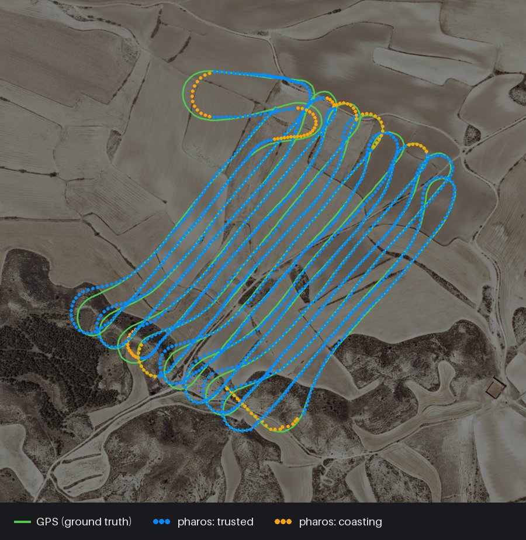

# Pharos

[](https://github.com/ahroonsanthosh/pharos/actions/workflows/ci.yml)

**Drone navigation without GPS.** Pharos finds a drone's position and heading
by matching its downward camera against free satellite or aerial imagery, so
it keeps working when GNSS is jammed, spoofed or simply not there. It runs on
a laptop CPU with no learned weights and no paid maps, and takes any video
feed with MAVLink (ArduPilot, PX4) or DJI telemetry, live or recorded.

It is built to fail safe: every position carries an honest uncertainty, and a
position is reported as trusted only when independent evidence supports it.

| Real flight (public data; GPS only to score) | Analysed after the flight | Live, in flight | Trusted but wrong |
|---|---:|---:|---:|
| Farmland survey, fixed-wing, 13 min | 93% | 67% | none |
| River valley survey, fixed-wing, 15 min | 87% | 47% | 2 frames, just past 25 m |

*Share of the flight with a trusted position within 25 m of GPS, from the
video alone.* In simulation, none of 27 scenarios (from snow, dusk haze and
spring clouds to Irish bog, 200 m uplands, a frozen video link and GNSS
jammed at 50 m) trusts a wrong position.



*Flight 1 analysed after the flight: pharos's estimate from the video alone
(blue trusted, orange coasting with its uncertainty) over the GPS track
(green). Orthophoto: PNOA © Instituto Geográfico Nacional, CC BY 4.0.*

Pharos is built to survive what changes between when the map was captured
and when the drone flies over: arbitrary heading, season, sun angle and
shadows, haze, altitude error, camera tilt, terrain, and land changes such as
crop rotation, construction and felling. A simulator generates realistic test
flights so every change is benchmarked before it meets hardware.

## Run it on a laptop

```bash
git clone https://github.com/ahroonsanthosh/pharos.git && cd pharos
docker compose up            # then open http://localhost:8000
```

The dashboard takes feeds from anywhere: a DJI controller or OBS pushing
RTMP/SRT, RTSP/HLS/UDP stream URLs, an HDMI capture card or webcam, recorded
videos with DJI `.SRT` telemetry, or a built-in demo flight. Telemetry
comes from MAVLink (ArduPilot/PX4), DJI subtitle files or manual entry;
recorded footage can also pair with an ArduPilot log. When
the aircraft reports GPS, it is drawn next to the visual estimate, so every
real flight measures accuracy. With **Start from GPS**, a feed begins from
the aircraft's GPS position and velocity at takeoff and never uses GPS
again, so later jamming or spoofing cannot pull it away; the **GNSS check**
then flags a receiver that keeps a confident fix while drifting further from
pharos's trusted position than both uncertainties allow, as a spoofed one
does. Setup for each source is in
[docs/laptop.md](docs/laptop.md).

## Analyze recorded footage

The same engine works on archives, not just live feeds: patrol logs, survey
photo sets, old flight videos. Footage is processed as fast as the CPU allows.

```bash
pharos analyze DJI_0042.MP4 --map area.tif --hfov 70        # .SRT next to the video is used
pharos analyze photos/ --map area.tif                       # EXIF GPS/time, DJI or senseFly XMP
pharos analyze old.mp4 --map area.tif --hfov 70 --altitude 120   # no telemetry at all
pharos analyze cam.mkv --map area.tif --hfov 77 --log flight.bin --log-sync 1.5   # ArduPilot
```

Barometric heights (DJI subtitles, MAVLink, an ArduPilot log's height above
home) are measured from the takeoff point, not the ground below. Pharos
downloads the free Copernicus 30 m terrain model for the map's area (once,
then cached) and turns them into heights above the ground. It finds the
takeoff point in telemetry that starts on the ground; otherwise give it with
`--takeoff LAT LON`, or pharos learns it from its first confirmed position.
`--dem` uses another elevation model and `--no-terrain` none.

When GNSS was good at the start of the footage and lost later (jammed, or
cut off on purpose), `--known-start SIGMA_M` begins from the first fixes, as
from the last ones before jamming: the position, known to within `SIGMA_M`
metres, and the velocity. GNSS is never used after that, only to score.
Footage that starts in mid-air reads its heights from a takeoff point it
never saw (a long DJI video split into parts does this); from a known start,
pharos then learns the true height from the first 3 s, by comparing the
ground odometry crosses with the distance the GNSS speed says it flew.

```bash
pharos analyze DJI_0043.MP4 --map area.tif --hfov 70 --known-start 5
```

A separate camera and an autopilot log share no clock; `pharos sync` finds
the offset from the footage alone. On a flight with GNSS, `pharos probe`
measures per-frame match quality and calibrates the camera once (mount
misalignment and effective field of view):

```bash
pharos sync cam.mkv --log flight.bin --log-sync 1 --hfov 77 --start 300
pharos probe cam.mkv --map area.tif --hfov 77 --log flight.bin --log-sync 1.5
```

Recorded footage is solved as a whole flight, so a turn or a gap is bridged
from both sides; `--causal` reports only what a live run would have. Give
`--map-accuracy` when the reference map itself may be metres off (e.g. 6 for
NAIP), so reported uncertainties include it.

It writes `track.geojson`, `track.kml` (opens in Google Earth), `track.csv`,
an overview image, and `summary.json`. When the footage carries its own GPS,
the summary scores Pharos against it. The dashboard offers the same exports
for every feed, live or recorded, and accepts photo sets as well as videos.

## Develop

```bash
pip install -e ".[dev,server,geo]"
pytest -q                                  # unit + end-to-end tests
pharos bench -j 4 -o runs/bench            # all built-in scenarios
pharos simulate autumn_low_sun -o runs/autumn      # a flight in the recording format
pharos localize --map runs/autumn/map.json --recording runs/autumn/recording -o runs/autumn/out
pharos serve --open                        # dashboard without Docker
```

## How it works

1. **Rectify.** Each frame is warped onto the ground at map resolution
   using its height above the ground and camera tilt. Over uneven ground the
   frame is projected through a terrain model, so a valley side rising
   towards the camera is not mistaken for larger ground.
2. **Describe.** Frame and map become dense orientation fields that keep
   edges (roads, field boundaries, buildings, shorelines) and discard
   intensity, contrast polarity, canopy texture and sun-driven shading.
3. **Correlate.** FFT cross-correlation scores every position at once, over a
   set of heading and altitude-scale hypotheses.
4. **Localize.** When lost, a global search proposes candidates. Several are
   followed in parallel until one clearly wins over 120 m of flight. A
   confirmed track is the last 40 s of frames solved jointly from visual
   odometry, gyro, compass and map matches, so a look-alike match is
   outvoted; it learns the odometry scale and compass bias as it flies. When
   matches stop, it dead-reckons with an uncertainty that grows honestly and
   looks for the track again only where that leaves the aircraft. Recorded
   footage is solved as a whole flight, bridging gaps from both sides.

Each estimate carries a status: `tracking` (trusted), `coasting` (a
position with an honest uncertainty, not trusted), `converging` (a candidate,
not yet a position) or `lost`. Details and design rationale are in
[docs/architecture.md](docs/architecture.md).

## Maps

Any north-up orthophoto works. Free sources include USGS NAIP, national
programmes such as IGN, swisstopo and PDOK, OpenAerialMap and Sentinel-2.
See [docs/data.md](docs/data.md) for sources, licences and the recording
format.

## Benchmark

Twenty-seven scenarios in `src/pharos/sim/scenarios/`, each a 60 s flight
at 180 m (`hills` at 120 m, `valley` at 110 m, the three Irish ones 120 s
at 110 m with a 16:9 camera, and the ten `stress_` ones as their files say)
over a 1.6 km × 1.6 km world, localized at 2 Hz against a summer
reference map, from a cold start (no initial position) except where a stress
scenario starts from a last GNSS fix:

<!-- bench:start -->
| scenario | avail | fix s | err50 m | err95 m | hdg deg | cover | mislead | gap s | in 3 sd | ms/frame |
|---|---:|---:|---:|---:|---:|---:|---:|---:|---:|---:|
| altitude_bias | 84% | 9.5 | 1.3 | 3.1 | 0.2 | 84% | 0.0% | 10 | 100% | 211 |
| autumn_low_sun | 85% | 9.0 | 1.8 | 3.9 | 0.2 | 85% | 0.0% | 9 | 100% | 267 |
| dusk_haze | 73% | 8.5 | 1.7 | 13.7 | 0.4 | 73% | 0.0% | 8 | 99% | 261 |
| grid_farmland | 84% | 9.5 | 1.6 | 3.5 | 0.2 | 84% | 0.0% | 10 | 100% | 266 |
| hills | 84% | 9.5 | 1.0 | 2.0 | 0.2 | 84% | 0.0% | 10 | 100% | 179 |
| ireland_bog_coast | 90% | 11.5 | 1.1 | 2.5 | 0.2 | 90% | 0.0% | 12 | 100% | 223 |
| ireland_pasture | 90% | 11.5 | 1.1 | 2.4 | 0.2 | 90% | 0.0% | 12 | 100% | 176 |
| ireland_uplands | 75% | 29.5 | 1.0 | 1.9 | 0.1 | 75% | 0.0% | 30 | 100% | 165 |
| kitchen_sink | 48% | 31.5 | 1.9 | 3.7 | 0.2 | 48% | 0.0% | 32 | 100% | 240 |
| land_change | 84% | 9.5 | 2.3 | 4.1 | 0.1 | 84% | 0.0% | 10 | 100% | 176 |
| no_compass_spinning | 84% | 9.5 | 2.1 | 3.9 | 0.0 | 84% | 0.0% | 10 | 100% | 228 |
| nominal | 85% | 9.0 | 1.4 | 2.5 | 0.1 | 85% | 0.0% | 9 | 100% | 178 |
| sensor_errors | 84% | 9.5 | 7.1 | 9.1 | 0.4 | 84% | 0.0% | 10 | 100% | 203 |
| spring_clouds_on_map | 56% | 9.5 | 2.6 | 6.6 | 0.3 | 56% | 0.0% | 17 | 100% | 190 |
| stress_descent | 90% | 11.5 | 1.5 | 6.0 | 0.5 | 90% | 0.0% | 12 | 100% | 134 |
| stress_gnss_lost_low | 75% | 5.0 | 2.0 | 14.0 | 0.6 | 75% | 0.0% | 22 | 100% | 93 |
| stress_hover | 90% | 11.5 | 1.3 | 3.4 | 0.3 | 90% | 0.0% | 12 | 100% | 197 |
| stress_map_offset | 90% | 11.5 | 9.5 | 10.7 | 0.2 | 90% | 0.0% | 12 | 100% | 192 |
| stress_midflight | 85% | 9.0 | 1.0 | 1.7 | 0.2 | 85% | 0.0% | 9 | 100% | 164 |
| stress_off_map | 47% | 11.5 | 1.1 | 2.6 | 0.1 | 47% | 0.0% | 53 | 100% | 203 |
| stress_rain | 90% | 11.5 | 1.1 | 2.9 | 0.2 | 90% | 0.0% | 12 | 100% | 169 |
| stress_telemetry | 55% | 11.5 | 1.3 | 6.3 | 0.2 | 55% | 0.0% | 44 | 100% | 201 |
| stress_tide | 90% | 11.5 | 1.1 | 2.5 | 0.2 | 90% | 0.0% | 12 | 100% | 227 |
| stress_video | 87% | 11.5 | 1.2 | 3.1 | 0.2 | 87% | 0.0% | 12 | 100% | 184 |
| tilted_camera | 85% | 9.0 | 1.3 | 2.8 | 0.1 | 85% | 0.0% | 9 | 100% | 233 |
| valley | 83% | 10.0 | 1.1 | 2.0 | 0.1 | 83% | 0.0% | 10 | 100% | 176 |
| winter_snow | 86% | 8.5 | 1.5 | 3.0 | 0.1 | 86% | 0.0% | 8 | 100% | 182 |
<!-- bench:end -->

Columns: share of frames trusted (`tracking`), time to first confirmed
fix, median and 95th-percentile error of trusted positions, median heading
error, accurate coverage (trusted and within 25 m) and the misleading rate
(trusted and further off), both over all frames, the longest stretch without
a trusted position, the share of trusted positions within three reported
sigmas, and median processing time per frame on a 4-core CPU running three
scenarios at once.

Reported uncertainties hold, and no frame in the whole benchmark is trusted
and wrong. The closest is `dusk_haze`, where low sun shifts shadow edges into
a run of strong matches 20 m off and the track follows them part of the way
(95th percentile error 14 m, 99% of trusted positions within three sigmas).
Coverage tops out near 85% because a candidate must cover 120 m of new
ground (about 10 s) before it is trusted. Lower rows report the missing
frames as coasting, not wrong: in `spring_clouds_on_map`, `kitchen_sink` and
`dusk_haze`, clouds on the map, haze and forest leave stretches where too
little matches for a 10 m uncertainty, and `kitchen_sink` takes 30 s to find
a distinctive start (the frame-sized template, a clear win on real 16:9
video, is mixed on this 4:3 camera: `winter_snow` now starts in 9 s instead
of 19 s); `sensor_errors` shows that a 2° camera mount misalignment becomes a
~6 m bias that no single frame can reveal.

`hills` is a DJI-style terrain-following survey over 150 m of relief whose
barometer reads up to 54% high, and `valley` flies a camera tilted 20° over
valleys 200 m deep; frames over both are ray-traced onto the terrain.
Projecting frames and odometry through the terrain instead of a plane halves
their errors (median 2.1 to 1.1 m and 2.5 to 1.0 m, 95th percentile 4.1 to
2.1 m and 4.7 to 2.0 m) and removes a 3.4° heading bias on `hills`, where
odometry read slopes across the track as turns. With a match in every frame
the scale the localizer learns keeps up with the barometer even without
terrain (84% either way); terrain heights pay where matches stop. Started
mid-flight, with 40 s of no matches, three flights over hills (two following
the terrain, one at a constant altitude) covered 58%, 57% and 37% of frames
with terrain heights against 42%, 45% and 37% without, none misleading, and
dead reckoning came out of the gap 1 to 7 m off instead of 24 to 69 m.

**Ireland.** Three scenarios model Irish ground and weather against a bright
summer map, each flown at 110 m with a DJI-style 16:9 camera:
`ireland_pasture` (small fields, nearly all grass and nearly all hedged, on a
grey winter day, a quarter of them flooded and half grazed or cut
differently since the map), `ireland_bog_coast` (blanket bog cut by drains,
rough grazing and stone-walled fields behind a ragged shoreline, in autumn
drizzle) and `ireland_uplands` (moor, bog and conifer plantation, a third
felled since the map, 200 m of relief under a terrain-following flight, low
cloud). Overcast light casts no shadows, so the hedges, walls, drains and
shorelines carry the match. Flown over several generated worlds each, none
of 14 flights trusted a wrong position and every reported uncertainty held:
pasture covered 90% in all four worlds, bog and coast 67 to 90% (mean 84%;
the 67% world coasted for a stretch), uplands 77 to 90% (mean 86%). The
uplands are the hard case for the search without a position, over relief:
there the previous search covered 60 to 90% (mean 82%), and its two
hardest worlds rose from 60 and 72% to 77 and 80%.

**When things go wrong.** Ten `stress_` scenarios, mostly over Irish
pasture, put a flight through what goes wrong in practice. A rain-spotted
lens (`stress_rain`), a coast at another tide than the map (`stress_tide`,
the shoreline 15 m inland), hovers of 20 and 10 s (`stress_hover`) and a descent
from 110 to 45 m after the first fix (`stress_descent`) each still cover
90%. A map georeferenced 10 m off (`stress_map_offset`) shifts every match
alike, which no matching can reveal: the error is the offset, and the 10 m
sigma still covers it. A telemetry dropout plus a compass pulled 45° off by
power lines for 15 s (`stress_telemetry`) cost 44 s of trust but nothing
wrong, and a flight that leaves a map cut too small for 42 s
(`stress_off_map`) coasts off it and re-locks about 8 s after it returns.
Two start from a last GNSS fix known to 10 m: GNSS jammed at 50 m
(`stress_gnss_lost_low`), and a flight joined in mid-air 80 m over hills
with heights read from a takeoff point 40 m off that ground
(`stress_midflight`), where the height learned from the speed gives 85%.
Two of them caught real faults. A frozen video link (`stress_video`)
repeats its last picture while the aircraft flies on; matched, that picture
held the trusted track 35 m behind with a 6 m sigma (7.4% of frames
misleading), so exact repeats are now neither matched nor used for odometry
(87% covered, none misleading). Low over pasture, odometry reads about 18%
short, and in `stress_gnss_lost_low` a trusted track drifted 20 to 28 m off
while it rejected true matches 1 to 3 m from the truth as too far from it
(2.5% misleading); a trusted track that keeps turning down matches agreeing
on one place now reports itself as coasting (none misleading, 75% covered).
On six real-flight runs (PinPoint 1 and 2, cold and from a known start, and
BAMBI) the second change altered the status of 3 live frames out of about
9,000 and nothing after the flight.

The simulator is still kinder than reality: the map and the drone view share
exact geometry, and the localizer knows the very terrain the frames were
rendered over, not a coarser model of it. Expect real cross-season match
scores to be lower and treat these numbers as an upper bound until validated
on flights.

## Real flights

Three public datasets, all free, each localized from a cold start with no
initial position; GNSS is used only to calibrate a camera once and to score.
Heights are barometric, corrected with the free Copernicus terrain model at
pharos's own position, so they need no GNSS either.
Every frame of a flight counts. A frame is **covered** when its position is
trusted and within 25 m of GNSS, and **misleading** when it is trusted and
further off. A trusted position has an uncertainty of at most 10 m and two
independent supporting matches; otherwise the position is still reported, as
coasting, with its honest uncertainty, so the table also scores every
position against its own sigma.

| flight | | covered | misleading | trusted within 3σ | any position within 25 m | any position within 3σ |
|---|---|---:|---:|---:|---:|---:|
| PinPoint 1: farmland, ~105 m, 13 min | live | 67% | 0.0% | 100% | 93% | 100% |
| | whole flight | 93% | 0.0% | 100% | 99% | 100% |
| PinPoint 2: river valley, ~80 m, 15 min | live | 47% | 0.1% | 99% | 82% | 99% |
| | whole flight | 87% | 0.0% | 100% | 96% | 100% |
| Aukerman: 77 photos, ~100 m | live | 22% | 0.0% | 100% | 39% | 100% |
| | whole flight | 43% | 0.0% | 100% | 77% | 100% |

*Live* is what the aircraft would have been told in flight; *whole flight*
is `pharos analyze` on the recording, solved at once. Flight 2 was localized
with the camera calibration from flight 1, out of sample.

Reported uncertainties hold: 99% or more of positions, trusted or coasting,
are within three sigmas of GNSS. The only frames trusted and wrong are two
borderline ones live on flight 2 (0.1%, 25.2 and 25.6 m off with sigmas of 9
to 10 m: within three sigmas, but past the 25 m line); other runs of flight 2
have had a few such frames (0.1 to 0.2%, 25 to 30 m off), with the
autopilot's terrain database as well as with pharos's.

Three changes got here. Making the uncertainty honest (dead reckoning,
overlapping matches counted as one, the estimator fixes below) removed the
earlier misleading frames (3.4% of flight 2's) but cost trusted coverage,
since positions trusted on optimistic sigmas then coasted. Matching the whole
frame instead of the disk inside it won that coverage back and more (flight 2
whole flight from 31% to 73%). The terrain then helped flight 2: in four
runs with it (heights, and later projection through it), flight 2 covered 78
to 90% of the whole flight and 44 to 47% live, against 73 to 77% and 37 to
40% in two runs with the autopilot's terrain database; flight 1 did not
change. Flight 2's results vary by about ten points between runs that differ
only in floating-point detail, because one acquisition more or less shifts a
whole stretch, so single runs say little. One such shift exposed a real
fragility: a run covered only 31% of flight 2 (16% live) because a wrong
leading candidate over higher ground set the height odometry used for every
candidate; with each candidate at its own height the flight covers 87% (47%
live). Projecting matches and odometry
through the terrain, not a plane, changed no coverage beyond that on these
flights, whose ground is mostly gentle (the median frame of flight 2 sees a
3% change of scale across it, the steepest tenth 17%), but it made odometry
steps in banks honest: flight 2's read 2.5% long and now 0.8%, flight 1's
4.0% and now 1.4%.

**A DJI video.** The *BAMBI* wildlife dataset (Zenodo, CC BY 4.0) publishes
raw DJI recordings with their `.SRT` files. One 6-minute DJI Mavic 3T segment
(4K, gimbal straight down, Styria) was run against Austria's free basemap.at
orthophoto. The survey flew 55 m above the ground (each frame sees about
70 × 40 m), mostly over continuous autumn forest and harvested fields
against a summer map, and the true location stood out in only 12% of
frames. From a cold start pharos never confirmed a position on it, nor
reported a wrong one, even given Airdata's heights. It also showed that DJI's `rel_alt` is height above
takeoff even on terrain-following missions: it read 46 to 112 m, a median
42 m too high, while the drone held 50 to 63 m above the ground. With the
Copernicus terrain model pharos brings that to within 3.5 m (median) of
Airdata's height above ground, most of the rest being forest canopy, which
the camera sees too.

The segment starts in mid-air, so it is also the case `--known-start` is
for: GNSS good at the start and lost after. From the first fixes (5 m), with
the raw `rel_alt` and the height learned from the speed, pharos covered 67%
of the 6 minutes after the flight and 63% live, median error 1.7 m (live
1.9 m, 95th percentile 2.3 m and 8.7 m), with no trusted position wrong and
every position, trusted or coasting, within three sigmas; it had a position
within 25 m in 93% of frames. See
[docs/data.md](docs/data.md#from-real-hardware) for how to fly and record
for pharos.

### Data and workflow

*PinPoint* (Zenodo, CC BY 4.0) is two flights of an ArduPlane VTOL with a
consumer camera (Sony IMX477, 1280×720 at 60 fps) on a pitch/yaw servo mount,
each with its ArduPilot `.bin` log; the camera and autopilot share no clock.
The map is Spain's PNOA orthophoto (IGN, CC BY 4.0, July 2024) over its free
WMS. *Aukerman* (OpenDroneMap, CC0) is a senseFly eBee survey, photos 4 to
22 s apart, matched against USGS NAIP 2015 (`--map-accuracy 6`: NAIP is good
to about 6 m).

1. `pharos sync` placed flight 1's video 1.54 s after the first GNSS fix
   (published by eye: 1.2 s; odometry steps disagree by 8.2 m at 1.2 s and
   by 1.8 m at 1.54 s). On flight 2 it agreed with the published value.
2. `pharos probe` on flight 1 measured an effective field of view of 76.7°
   (published 72.3°) and a mount offset of 4.4° back, 3.0° right.
3. `pharos analyze` over the cruise part of each flight at 2 frames/s.

### What real footage taught

* **Use the whole frame.** Matching took the largest disk inside the frame, so
  a 16:9 camera used only its short side. At flight 2's 80 m that was 72 m
  of ground out of 127 × 71 m; matching all of it, the true location stood
  out from noise in 62% of frames instead of 40%, and at a stricter
  threshold chance peaks passed less often than before. This one change took
  flight 2 from 32% to 73% covered.
* **Overlapping frames are one observation.** Consecutive frames see the same
  ground, so a look-alike fools a run of them alike. Counted as independent,
  sixteen such matches in a test outvoted odometry and the solve claimed 3 to
  5 m while 50 m off. Matches less than 40 m apart now share one vote; on flight 1
  this alone cut the whole-flight misleading rate from 1.9% to 0.5%.
* **Lost is not unknown.** A lost track keeps dead reckoning, reported with
  a growing sigma, and the search for a new track is confined to where that
  leaves the aircraft (every third search still covers the whole map, in
  case the lost track was already wrong). An untrusted track that keeps
  rejecting matches pointing to one place gives up its belief and lets that
  place compete for confirmation.
* **Estimator bugs hide behind matches.** Dead reckoning without matches
  exposed four, each of which made the error explode while the sigma
  collapsed: old information was forgotten a little more every frame, a
  missing odometry step at the window's edge erased the position, the
  velocity prior pulled the odometry scale to zero, and a full step could
  push the scale through zero. Six minutes of pure dead reckoning on either
  flight now stays within three sigmas from every start tried.
* **Wind turns with the aircraft.** The crab angle flips from one leg to the
  next (yaw minus track went from +19° to −14° in one turn), so body-frame
  velocity changes in every turn. A stiffer velocity prior left dead
  reckoning 36 m off 10 s into a bank with a 16 m sigma; the looser one,
  21 m.
* **ArduPilot logs nonsense at gimbal lock.** A servo mount pointing straight
  down logs roll −90, yaw −90 for a camera at roll 0, yaw 3. Those samples
  inherit roll and yaw.
* **A compass rules out turning around.** Line-dominated ground matches
  almost as well turned 180°, so the wide search used to propose every
  candidate both ways. After a U-turn on flight 2 the track was lost, the
  search around its dead-reckoned position proposed a candidate turned 150°
  from the compass, it won the quick reacquisition near the lost track, and
  the new track flew backwards, up to 900 m off with a sigma of tens of
  metres. Turned-around candidates are now proposed only where the heading
  is unknown.
* **Every candidate flies at its own height.** Odometry runs once per frame,
  at the height above the ground under the most likely position. While
  candidates compete that is the leading one, and on flight 2 a wrong lead
  1.9 km away over higher ground put the aircraft 19 to 37 m above the
  ground instead of about 80: the true candidate, moved at a quarter of its
  speed, kept losing its matches. Each candidate's odometry now scales by
  its own height above the ground.
* **Ridges.** Along a straight field edge the correlation peak is a line;
  each match reports its peak's spread, and the estimator uses it.
* **Sync is attitude, and so are banks.** 0.3 s of clock error gives every
  frame the bank angle of another moment. Half the confident matches above
  20° of bank were 20 m or more off, so only odometry runs beyond 30°, or
  beyond 20° while rolling.
* **Barometers measure from the takeoff point.** DJI's `rel_alt` read a
  median 42 m too high on a terrain-following survey, and over flight 2's
  valley the height above home was up to 23 m off the ground. Copernicus
  GLO-30 at the GNSS position agrees with ArduPilot's own terrain database to
  a median of 1 to 2 m on both PinPoint flights, and pharos looks it up at
  its own position instead. Over a steep valley side a position error becomes
  a height error (a track 40 m off read the ground 10 to 15 m wrong), so the
  terrain is averaged over where the aircraft may be.
* **Photo GPS altitude was above the ellipsoid, not sea level** (34 m, a
  50% scale error at 100 m), and the eBee's camera attitude convention had to
  be read from the data. The map whose season matches the flight wins.
* **Tried and rejected:** averaging aligned score maps over several frames
  (flight 1 live coverage 70% to 62%, misleading 0.5% to 1.4%); a 12 m trust
  threshold (flight 2 misleading 6.3%); counting nearby matches as only
  partly correlated (more coverage, but look-alike runs back: flight 1
  misleading 0.4% to 0.9%); full confirmation for a place that
  contradicted a coasting track (flight 2 live coverage 40% to 21%);
  keeping a lost track's place open for 300 s instead of 60 s (no gain
  across two samples of flight 2); a higher score floor for matches (0.25
  instead of 0.18: on real footage it cut look-alikes passing a candidate's
  local check from 5 to 11% to about 1.5%, but whole runs did not improve and
  the simulator lost coverage); letting a strongly scoring match count with
  less margin over its search window around a trusted track (better on
  flight 2, but on the BAMBI flight it took a match 10.6 m off during an
  odometry drift and trusted 0.7% of live frames wrongly; it stays an option, `track_strong_score`, off by default).

## Next steps

* **Acquisition speed.** A whole-map search normalizes the frame-shaped
  template once per heading and takes about twice as long as with the disk;
  a nadir footprint is symmetric, so half of those could be shared.
* **More information per match.** Over flight 2's valley the true place
  still stands out in only 62% of frames. Stitching consecutive frames into a
  longer template did not help in simulation (no change over pasture, mixed
  to worse over uplands); learned features behind the `Matcher` protocol are
  the next lever.
* **A first position from low down.** At 40 m a cold start takes 45 to 60 s
  in simulation, against none from a known start: wrong candidates fill
  every slot and the true one, which the global search keeps finding again,
  is dropped. Two options aim at this (`evict_stale`, `refound_distinct`,
  off by default) and still need whole-flight runs. Odometry also reads
  about 18% short at 50 m.
* **An Irish flight.** The Irish scenarios are simulated. The test that
  counts is a real flight over Irish pasture or bog against a free map of
  it, which in Ireland means surveying the area once yourself (see
  [docs/data.md](docs/data.md)).
* **Finer terrain.** Copernicus GLO-30 is a 30 m model: cliffs, buildings
  and tree lines are smoothed out of it. A national lidar model (`--dem`, often
  1 m) would capture them where a low flight sees them.
* **Lens distortion:** consumer cameras need undistorting; it matters most at
  the image edges a banked view relies on.
* **More real flights:** a DJI MP4 + SRT gives ground truth for free.

## Layout

```
src/pharos/
  geometry.py  geomap.py  terrain.py  types.py  recording.py  config.py  cli.py
  footage.py  analyze.py  telemetry.py  sync.py
  vision/   rectify, features, correlate, matcher, odometry
  nav/      filter, window, localizer
  sim/      world, appearance, trajectory, flight, scenario, scenarios/*.yaml
  eval/     metrics, plot, bench, export
  server/   app, feeds, store, static/ (dashboard)
docs/       laptop setup, architecture, data sources
tests/
Dockerfile  compose.yaml
```

## License

Copyright (C) 2026 Ahroon Santhosh.

Pharos is free software under the [GNU Affero General Public License v3.0](LICENSE)
(AGPL-3.0-only): you may use, study, change and share it, and if you
distribute it, or let others use a changed version over a network, you must
publish your source under the same licence. To build pharos into a
proprietary product or service instead, a commercial licence is available
from Heloria Labs: contact [@ahroonsanthosh](https://github.com/ahroonsanthosh).
Outside contributions are accepted under a contributor licence agreement,
so that both licences stay possible.
